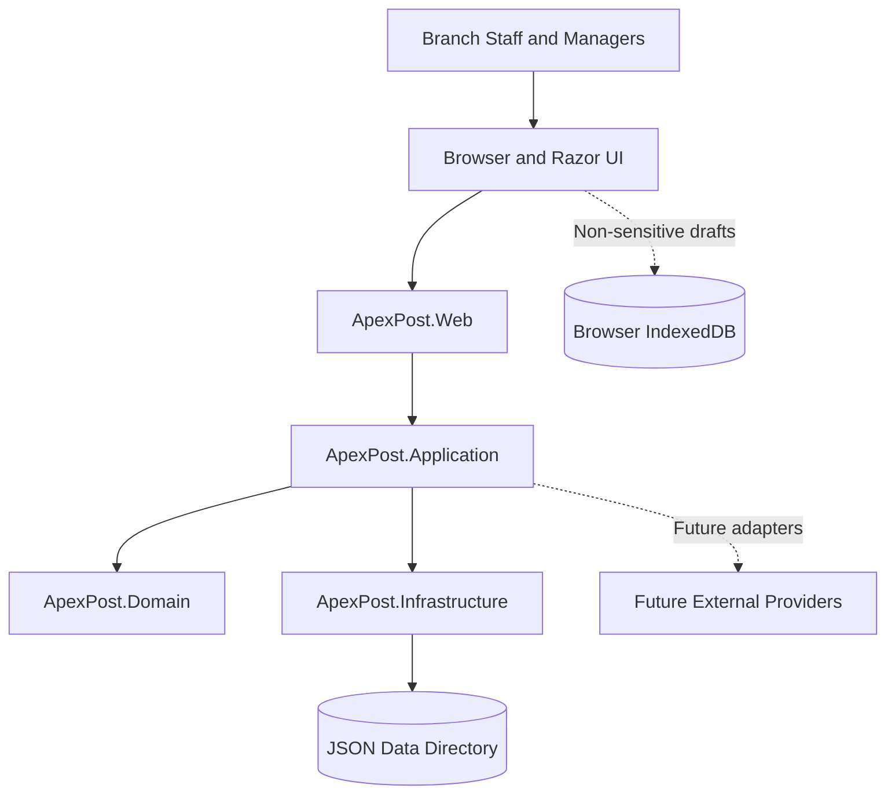
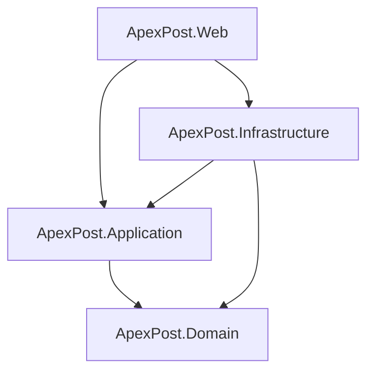
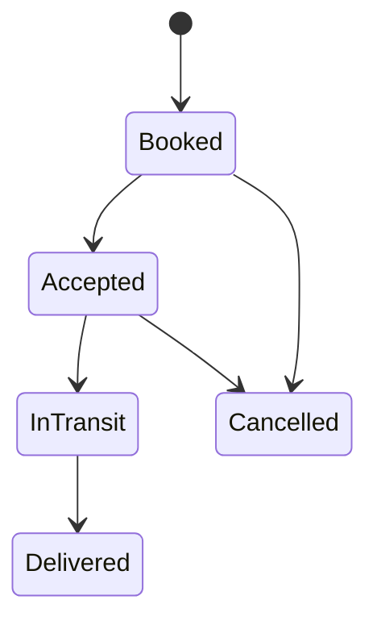

# ApexPost Logistics — System Design

**Project:** ApexPost Logistics — Secure, Observable Retail Counter Platform  
**Application type:** ASP.NET Core MVC  
**Architecture:** Layered architecture with domain-driven design principles  
**Framework:** .NET 10  
**Language:** C# 14  
**Current persistence:** JSON file-backed collections  
**Client-side storage:** IndexedDB for non-sensitive drafts and queue metadata  
**Delivery stage:** Local development and controlled internal deployment

---

## 1. Purpose and Scope

ApexPost Logistics is a branch-operations platform designed to support the day-to-day activities of retail service counters. It brings branch administration, staff management, catalogue and pricing, inventory control, shipment processing, money orders, identity verification, payments, transaction processing, and operational auditing into a unified application.

The system is designed around explicit business rules, controlled access, observable request processing, and safe persistence. It favors understandable components and predictable behavior over premature architectural complexity.

The current implementation uses JSON-backed persistence to support local development, repeatable demonstrations, and controlled internal deployments. The architecture establishes boundaries that allow the persistence implementation to evolve without requiring the entire application to be rewritten.

### 1.1 Primary objectives

- Maintain a clear separation between business rules, application workflows, persistence, and HTTP presentation.
- Enforce domain invariants close to the entities and value objects that own them.
- Provide secure authentication and role-based authorization.
- Support realistic branch and counter operations.
- Preserve existing operational data during startup and seeding.
- Detect malformed JSON and invalid configuration instead of silently replacing data.
- Make important operations traceable through correlation identifiers and audit records.
- Support automated testing at domain, application, infrastructure, and web levels.
- Establish a migration path toward a transactional database.

### 1.2 Scope boundaries

The current phase focuses on a secure, maintainable application foundation and operational workflows.

The following are not assumed to be complete production capabilities:

- Distributed transactions or cross-instance locking.
- Guaranteed atomic multi-file business operations.
- External payment-provider processing.
- External identity-verification provider integration.
- Multi-region deployment and disaster recovery.
- Enterprise identity federation.
- A managed relational or document database.

These capabilities may be introduced as the system's operational and business requirements mature.

---

## 2. Architectural Principles

ApexPost follows these design principles.

### 2.1 Separation of concerns

Each layer owns a specific responsibility. Controllers do not implement business invariants, domain entities do not access files, and infrastructure components do not decide who is authorized to perform a business operation.

### 2.2 Domain-first business rules

Rules such as stock quantities never becoming negative, shipments following valid status transitions, and money-order verification requirements belong in the domain model or in explicit application workflows that coordinate the relevant domain objects.

### 2.3 Explicit failure

Invalid input, persistence failures, malformed JSON, authorization failures, and conflicting updates must produce recognizable failures. The application must not silently convert failures into success or replace valuable data with empty defaults.

### 2.4 Dependency inversion

Application use cases depend on abstractions for persistence and external services. Infrastructure implements those abstractions. This makes it possible to replace JSON storage without making controllers dependent on a particular storage mechanism.

### 2.5 Secure by default

Authentication, authorization, antiforgery validation, input validation, safe logging, and secret management are design requirements rather than optional additions.

### 2.6 Incremental delivery

Features are introduced in small, verifiable steps. Each significant change should build successfully, pass relevant tests, and have a clear Git history.

### 2.7 Operational simplicity

The application should be straightforward to configure, start, inspect, test, back up, and restore. Operational state must be distinguished from source code and disposable build artifacts.

---

## 3. System Context

ApexPost is a server-rendered web application. Browsers communicate with the ASP.NET Core application over HTTP or HTTPS. The application authenticates users, authorizes requests, coordinates business workflows, and persists operational records through Infrastructure.



### 3.1 Main actors

**Counter clerk**
- Performs authorized counter operations.
- Processes supported retail and shipping services.
- Records permitted inventory movements.
- Views operational information within assigned permissions.

**Branch manager**
- Performs branch-level operational oversight.
- Manages permitted staff, catalogue, inventory, and reporting functions.
- Reviews transactions and exceptions within authorized scope.

**Administrator**
- Performs authorized system-wide management.
- Manages administrative configuration and permitted bootstrap or access-management functions.
- Has access only to functions explicitly covered by administrator authorization policies.

Actual permissions must be determined by the application's configured policies and claims. A role name alone should not imply unrestricted access to every business operation.

---

## 4. Solution Structure and Layer Responsibilities

The solution contains four production projects and four corresponding test projects.

```text
ApexPost/
├── ApexPost.sln
├── global.json
├── Directory.Build.props
├── Directory.Packages.props
├── .gitignore
├── README.md
├── DESIGN.md
│
├── docs/
│   ├── architecture/
│   ├── adr/
│   └── api/
│
├── data/
│   ├── seed/
│   └── samples/
│
├── src/
│   ├── ApexPost.Domain/
│   ├── ApexPost.Application/
│   ├── ApexPost.Infrastructure/
│   └── ApexPost.Web/
│
├── tests/
│   ├── ApexPost.Domain.Tests/
│   ├── ApexPost.Application.Tests/
│   ├── ApexPost.Infrastructure.Tests/
│   └── ApexPost.Web.Tests/
│
└── scripts/
    ├── validate-seed-data.ps1
    └── run-tests.ps1
```

This tree represents the intended organization; individual files may be added as implementation evolves.

### 4.1 Domain

**Project:** `ApexPost.Domain`

Owns:
- Business entities and value objects.
- Domain validation and invariants.
- Valid business state transitions.
- Domain-specific exceptions and shared primitives.
- Domain concepts independent of the web framework and storage provider.

Representative concepts include:

- Branches, addresses, branch codes, and branch status.
- Staff members, employment status, and staff roles.
- Catalogue services, service codes, and availability.
- Inventory items, SKUs, and stock movements.
- Shipments, shipment parties, packages, charges, and lifecycle status.
- Money orders and identity-verification state.
- Counter transactions, transaction lines, payments, and totals.

The Domain project must not depend on ASP.NET Core, Infrastructure, or Web. It should not read or write JSON files.

### 4.2 Application

**Project:** `ApexPost.Application`

Owns:
- Use cases and business workflow coordination.
- Request and response DTOs.
- Application-level validation and result conventions.
- Repository and external-service interfaces.
- Authorization-relevant workflow checks where required by the use case.
- Cancellation-token propagation for asynchronous operations.
- Coordination of operations spanning multiple domain entities.

Examples of use cases include:
- Create or deactivate a branch.
- Register or deactivate a staff member.
- Receive or issue inventory.
- Book, accept, dispatch, cancel, or deliver a shipment.
- Create and process a money order.
- Process a mixed counter transaction.
- Query operational reports.

Application should depend on Domain, not on Web or concrete Infrastructure implementations.

### 4.3 Infrastructure

**Project:** `ApexPost.Infrastructure`

Owns:
- JSON serialization and deserialization.
- File-backed collection stores.
- Persistence adapters implementing Application interfaces.
- JSON data-directory initialization.
- Business data seeding and data validation.
- File access coordination and persistence-specific errors.
- Adapters for clocks or external providers where required.

Infrastructure translates between persisted representations and domain objects. It must preserve domain invariants during restoration rather than bypassing them with unchecked object construction.

### 4.4 Web

**Project:** `ApexPost.Web`

Owns:
- ASP.NET Core startup and dependency injection composition.
- Cookie authentication and authorization-policy registration.
- MVC controllers, Razor views, and HTTP endpoints.
- Middleware and exception handling.
- Antiforgery configuration and request validation.
- Rate limiting for appropriate endpoints.
- Correlation identifiers and HTTP-level observability.
- Health endpoints that disclose no sensitive information.
- Static assets and client-side IndexedDB functionality.

Controllers should remain thin. They bind and validate HTTP input, invoke application use cases, and translate application outcomes into suitable HTTP responses or MVC views.

### 4.5 Test projects

| Project | Main responsibility |
|---|---|
| `ApexPost.Domain.Tests` | Domain invariants and lifecycle transitions |
| `ApexPost.Application.Tests` | Use-case behavior and workflow outcomes |
| `ApexPost.Infrastructure.Tests` | JSON persistence, seeding, and restoration |
| `ApexPost.Web.Tests` | HTTP behavior, authentication, authorization, and antiforgery |

Tests should verify behavior rather than merely asserting that classes or methods exist.

---

## 5. Dependency Rules

The intended dependency graph is:



### 5.1 Dependency constraints

- Domain has no dependency on the other application layers.
- Application depends on Domain.
- Infrastructure implements Application abstractions and uses Domain concepts.
- Web composes Application and Infrastructure at startup.
- Domain must not reference JSON stores, controllers, Razor views, or framework-specific HTTP objects.
- Application DTOs should not expose Infrastructure-specific types.
- Controllers should not instantiate JSON stores directly.

The Web-to-Infrastructure dependency is acceptable for composition-root registration. Business use cases should still communicate through abstractions.

---

## 6. Domain Model and Business Boundaries

The domain is organized around operational concepts rather than database tables. Entities protect their own invariants, and value objects represent validated concepts such as identifiers, codes, quantities, and money.

### 6.1 Branch management

A branch represents a physical or operational service location.

Important rules include:
- Branch identity and branch code must be valid.
- Branch status must be recognized.
- Closed branches must not accept new operations that require an open branch.
- Branch references in staff, inventory, and transaction records must be valid.
- Counter availability and capacity rules must be checked before counter operations.

Branch activation and closure should be explicit business operations, not arbitrary status-string updates.

### 6.2 Staff management

Staff members are assigned to branches and carry roles or permissions appropriate to their work.

Important rules include:
- Employee identifiers must be valid and unique within the defined business scope.
- Inactive staff must not perform transactions.
- Staff must belong to a valid branch.
- Only authorized users can create, update, deactivate, or reassign staff.
- A staff role does not replace authentication or endpoint authorization.

### 6.3 Catalogue and pricing

The catalogue defines services available to customers. Pricing records define the monetary charge for eligible services.

Important rules include:
- Service codes must be validated and unique within their intended scope.
- Unavailable services must not be selected for new operations.
- Prices must use explicit currency information.
- Monetary calculations must use decimal-based arithmetic rather than binary floating-point values.
- A transaction should preserve the price applied at the time of the transaction, so later price changes do not rewrite historical totals.

Catalogue availability and pricing should be managed independently where the business model requires it.

### 6.4 Inventory

Inventory is branch-specific. Each inventory item has an identity, branch, SKU, name, reorder level, quantity on hand, and stock-movement history.

Stock changes should be represented as movements rather than unexplained direct quantity edits.

Supported movement types include:
- Receipt.
- Issue.
- Adjustment increase.
- Adjustment decrease.

Important rules include:
- Quantities received must be positive.
- Issued quantities must be positive and cannot exceed stock on hand.
- The resulting quantity on hand must never be negative.
- Reorder levels cannot be negative.
- Every movement must have a valid reason and timestamp.
- An adjustment must actually change the current quantity.
- Stock movements should remain traceable to their originating operation where the application workflow supports it.

Inventory initialization should use the domain's stock-receipt operation or a validated restoration mechanism so quantity and movement history remain consistent.

### 6.5 Shipments

A shipment represents a delivery service requested by a sender for a recipient.

A shipment contains:
- Shipment identity and shipment number.
- Sender and recipient.
- Selected catalogue service identity.
- Package details.
- Charge details.
- Shipment lifecycle status.

The normal lifecycle is:



The domain controls which transitions are valid. A shipment cannot be delivered directly from the booked state or cancelled after it has entered transit.

The application should validate service availability, package limits, required party details, and pricing before persisting a booking. Shipment charges should preserve the applied monetary amount and currency needed for historical accuracy.

### 6.6 Money orders and identity verification

Money orders represent a financial service and must distinguish the principal amount from service fees and applicable taxes.

Important design requirements include:
- Validate the principal amount and currency.
- Apply the required identity-verification workflow before permitting high-value operations.
- Record verification outcomes and the minimum necessary supporting metadata.
- Restrict access to sensitive identity information.
- Avoid placing identity documents, credentials, or sensitive personal data in ordinary application logs.
- Treat provider integration as simulated until a real provider has been implemented and verified.

Verification requirements should be driven by explicit business policy, not hidden assumptions in controllers.

### 6.7 Counter transactions

A counter transaction can contain a mixed basket of eligible services, such as retail items, shipping services, and money orders.

The transaction workflow should:
1. Validate the branch and staff member.
2. Validate service availability and applicable permissions.
3. Validate inventory availability for stock-controlled items.
4. Calculate line amounts, fees, taxes, and totals using defined rounding rules.
5. Apply identity-verification requirements where relevant.
6. Validate payment information.
7. Record the transaction outcome.
8. Record associated stock movements and audit metadata.

The current JSON implementation does not automatically provide atomic commits across multiple files. Multi-step workflows must therefore define how partial failures are detected, reported, reconciled, and tested. Critical financial operations should not be described as transactionally safe until the persistence mechanism guarantees the required behavior.

---

## 7. Application Use-Case Design

Application workflows form the boundary between presentation and domain behavior.

### 7.1 Request lifecycle

A typical use case follows this sequence:

1. Receive a typed request DTO.
2. Validate required fields and request-level constraints.
3. Load the relevant entities through repository interfaces.
4. Check existence, branch scope, and applicable business preconditions.
5. Invoke domain behavior.
6. Persist the resulting state.
7. Return a typed result describing success or a known failure.
8. Allow unexpected failures to reach centralized exception handling.

### 7.2 Result handling

Application operations should use a consistent result convention for expected outcomes.

Examples include:
- Success.
- Validation failure.
- Resource not found.
- Conflict or duplicate record.
- Invalid business-state transition.
- Unauthorized operation where applicable to the use case.
- Persistence failure.

The exact result type may vary, but controllers should not need to parse exception messages to decide whether an operation succeeded.

Unexpected infrastructure failures must not be converted into misleading success results.

### 7.3 Validation boundaries

Validation should occur at multiple levels for different purposes:

- **HTTP validation:** request binding, required fields, and input format.
- **Application validation:** use-case prerequisites and cross-entity checks.
- **Domain validation:** invariants that must always hold.
- **Persistence validation:** JSON structure, schema expectations, identity consistency, and concurrency safeguards.

Duplicating a rule across layers is acceptable when each layer serves a distinct protective purpose. The domain remains the final authority for its invariants.

### 7.4 Cancellation

Asynchronous application and infrastructure operations should accept and propagate `CancellationToken` values. Cancellation must not leave an operation falsely reported as complete. Where a workflow contains multiple steps, cancellation behavior and any partial changes must be explicitly considered.

---

## 8. JSON Persistence Architecture

JSON persistence is the current storage implementation, not the business model itself.

### 8.1 Data-directory configuration

The data directory is controlled through configuration, using the `ApexPost:JsonData:DataDirectory` setting and the corresponding `JsonDataOptions` class.

The effective directory must be understood relative to the application's runtime working directory when a relative path is used. Deployment environments should prefer an explicit, stable path.

Example configuration:

```json
{
  "ApexPost": {
    "JsonData": {
      "DataDirectory": "App_Data"
    },
    "Seed": {
      "Enabled": false
    }
  }
}
```

The seed section shown here is illustrative; it must match the actual options binding and configuration registration in the project.

The data directory is operational state. It must not be treated as disposable output or casually replaced during deployment.

### 8.2 Collection storage

Each logical collection is persisted separately, for example:

```text
App_Data/
├── branches.json
├── staff.json
├── catalogue.json
├── pricing.json
├── inventory.json
├── shipments.json
├── money-orders.json
├── transactions.json
├── audit.json
└── accounts.json
```

This is an illustrative list of potential files, not a guarantee that every file is already implemented. Actual filenames must follow the repository configuration and persistence adapters.

### 8.3 Safe initialization

Startup initialization should:
- Resolve and create the configured data directory.
- Respect the seed-enabled setting.
- Validate existing business JSON before attempting seed operations.
- Avoid overwriting existing operational data.
- Avoid modifying account or login data during business seeding.
- Use deterministic identifiers where repeatable seed records are required.
- Use domain constructors and restoration methods to preserve invariants.
- Stop with a clear persistence error when existing data is malformed or unreadable.

Seeding must be idempotent: running it repeatedly should not create duplicate copies of the same seeded records.

### 8.4 Malformed and incompatible data

Malformed JSON must not silently become an empty collection if doing so could hide or overwrite operational records.

Deserialization should distinguish:
- Invalid JSON syntax.
- Valid JSON with an incompatible data shape.
- Missing optional files.
- Missing required fields.
- Unsupported schema versions.
- I/O permission or disk failures.

Errors should identify the affected resource without disclosing secrets or sensitive personal data.

### 8.5 File-write safety

For important writes, the persistence implementation should consider:
- Writing to a temporary file before replacing the target.
- Flushing and closing file streams appropriately.
- Validating serialized output where justified.
- Coordinating concurrent writers.
- Detecting conflicting updates.
- Preserving a recoverable copy before destructive changes when operationally required.

Atomic file replacement and process-level locking must be verified for the actual operating system and filesystem. They do not by themselves provide multi-file transactions or distributed locking.

### 8.6 Concurrency limitations

JSON files do not inherently provide database-grade concurrency control. Two requests may attempt to update the same record or file at the same time.

The current implementation should explicitly define its guarantees. Where the repository supports version numbers or expected-version checks, use them to detect stale writes. Do not claim that version metadata provides concurrency safety unless the check and write are performed as one coordinated operation.

### 8.7 Backups and restoration

Operational backups should:
- Capture a consistent copy of the data directory.
- Protect account and audit data.
- Be stored outside public web directories.
- Have access controls and retention policies.
- Be tested through restoration exercises.
- Include a documented recovery procedure.

A backup is not considered reliable until it has been successfully restored and the resulting data validated.

---

## 9. Seed Data Design

Seed data supports development, demonstration, and repeatable testing. It is separate from real operational data.

### 9.1 Seed-data requirements

- Seed records must satisfy domain invariants.
- Branch references must resolve.
- Staff assignments must reference valid branches.
- Inventory items must reference valid branches.
- Shipments must reference valid catalogue services.
- Stock movement history must agree with the final quantity on hand.
- Shipment status must be reachable through valid lifecycle transitions.
- Seed identifiers must be stable where idempotency requires them.
- Re-running seeding must not duplicate existing records.

### 9.2 Account separation

Business seeding must not create, overwrite, reset, or delete login accounts. Account bootstrap should be a separate, explicitly secured workflow using the application's configured password-hashing and first-user bootstrap requirements.

Seed files must not contain real passwords, password hashes copied from production, access tokens, real identity documents, or other credentials.

### 9.3 Seed versus production data

Production startup should not automatically inject demonstration records into an existing operational dataset. Seeding should be explicitly configured and should validate the destination before making changes.

The seed process must not treat a malformed existing file as permission to regenerate that file.

---

## 10. Authentication and Authorization

Authentication determines who the user is. Authorization determines which operations the authenticated user may perform.

### 10.1 Cookie authentication

ASP.NET Core cookie authentication is used for the MVC application.

Cookie configuration should include:
- HTTPS-only transmission in deployed environments.
- `HttpOnly`.
- An appropriate `SameSite` policy.
- A bounded expiration period.
- Sliding renewal only where appropriate.
- Secure login and logout behavior.
- Safe handling of return URLs.
- Clear unauthorized and access-denied behavior.

Local development exceptions should not weaken production configuration.

### 10.2 Authorization policies

Named policies such as `Management` and `AdministratorOnly` centralize access rules.

Policies should be applied to the appropriate controllers, actions, or endpoints. Sensitive operations may require resource-level checks in addition to role policies—for example, ensuring a branch manager can only manage records within their permitted branch scope.

Hiding a navigation link is not an authorization control. The server must enforce permissions for every protected request.

### 10.3 First-user bootstrap

The initial administrator workflow must be explicitly controlled.

Requirements include:
- Strong password requirements.
- Safe password hashing through ASP.NET Core's password-hashing facilities.
- No plaintext password persistence.
- Protection against repeated or unauthorized bootstrap attempts.
- A clear transition from bootstrap mode to normal operation.
- No hard-coded production credentials.

### 10.4 Login rate limiting

Login endpoints should use rate limiting or equivalent abuse controls. Limits should be configured and tested against expected usage, and failures should not reveal whether a specific account exists.

Rate limiting is one layer of defense and does not replace secure password handling or monitoring.

### 10.5 Antiforgery

State-changing browser form submissions must use antiforgery protection. Cookie-authenticated requests should not rely solely on the fact that a user has an active session.

The implementation must verify that antiforgery validation is applied to relevant actions and that unsafe HTTP methods are not used for read-only navigation.

---

## 11. Security and Privacy

Security is applied at the boundaries where untrusted input enters, privileged actions occur, or sensitive information is stored.

### 11.1 Input handling

- Validate request models.
- Enforce length and range limits.
- Normalize identifiers and codes consistently.
- Avoid trusting client-side validation.
- Use output encoding and safe Razor rendering.
- Prevent unvalidated user input from controlling file paths.
- Restrict uploads and external resource access if such features are introduced.

### 11.2 Sensitive information

Sensitive information must not be written to ordinary application logs, correlation metadata, exception messages, or browser-local storage.

Audit records should contain the minimum information required for accountability. Identity-related records require explicit access controls and retention rules.

### 11.3 IndexedDB restrictions

IndexedDB may store non-sensitive draft content and queue metadata when required by the user experience.

It must not store:
- Passwords.
- Authentication tokens or session material.
- Password hashes.
- Identity documents or sensitive verification evidence.
- Server-confirmed financial records as the authoritative source of truth.

Browser storage can be altered or deleted by the user. The server must revalidate queued operations before processing them.

### 11.4 Security failure handling

- Authentication failures should not disclose secrets.
- Authorization failures should not expose protected resource details.
- Persistence failures should not return raw stack traces to users.
- Health endpoints should disclose only the minimum operational information required.
- Unexpected exceptions should be logged through controlled, redacted logging.

### 11.5 Security review boundary

This design documents intended controls. It is not evidence that every control has been implemented, tested, or independently audited. Security readiness must be established through code review, configuration inspection, automated tests, and operational verification.

---

## 12. Middleware and Observability

The HTTP pipeline should provide consistent handling of errors, request tracing, security controls, and operational signals.

### 12.1 Middleware responsibilities

The pipeline may include:
- Centralized exception handling.
- Correlation-ID handling.
- HTTPS redirection in deployed environments.
- Static-file serving.
- Routing.
- Rate limiting.
- Authentication.
- Authorization.
- Antiforgery validation through MVC filters or endpoint conventions.
- Controller and Razor view execution.

Middleware ordering matters. Authentication must execute before authorization, and endpoint-specific middleware must be positioned according to the framework's requirements.

The actual order should be verified against the project's `Program.cs`.

### 12.2 Correlation identifiers

Each request should have a traceable correlation identifier. If an inbound identifier is accepted, it must be validated and bounded before use. Otherwise, the application should generate a safe identifier.

Correlation identifiers may appear in:
- Structured logs.
- Error responses where appropriate.
- Audit metadata when useful.
- Diagnostic output.

They must not contain secrets or personally sensitive values.

### 12.3 Audit trail

Auditing should capture important business events, such as:
- Branch status changes.
- Staff activation or deactivation.
- Inventory receipts, issues, and adjustments.
- Shipment lifecycle transitions.
- Money-order processing outcomes.
- Transaction completion, void, or refund operations.
- Administrative changes.

Application use cases and `OperationalAccess` write audit events through the Application audit abstraction. MVC filters add controlled request/action telemetry; they do not replace business-event auditing. Events record UTC time, server-resolved staff ID and role when available, validated branch scope, operation, target reference, outcome, correlation ID, and a strict allowlist of safe metadata. No request body, free-form reason, password, API key, payment secret, or identity-document value is copied.

Sensitive mutations append a `Started` event before the business repository write and a terminal `Succeeded` or `Failed` event afterward. An audit failure before the mutation propagates and prevents the write. If the terminal audit write fails after a business file was saved, the request fails safely and the preceding `Started` event remains for reconciliation; JSON files cannot atomically commit the business record and audit record together. Audit-write exceptions are handled by the global safe error pipeline and are not swallowed by the audit filter.

`JsonAuditWriter` exposes append operations only. It uses the JSON collection store's process-local lock and temporary-file replacement. Malformed audit JSON is not auto-repaired; the write fails and leaves the existing file untouched. This protects against ordinary partial writes and concurrent writes in one process, but it is not tamper resistant, does not coordinate multiple processes, and does not provide atomic multi-file business transactions. See `AUDIT-SAMPLE.json` for synthetic records.

### 12.4 Health endpoints

Health endpoints should distinguish basic process availability from dependency readiness where applicable.

A successful process-health response does not necessarily prove that every JSON collection is valid or that all business operations can complete.

Health responses must not expose:
- Password hashes.
- Secret configuration values.
- Raw environment variables.
- Full filesystem paths where unnecessary.
- Sensitive records or detailed internal exception traces.

---

## 13. Error Handling and Failure Semantics

ApexPost should treat errors as explicit outcomes, not incidental strings.

### 13.1 Expected failures

Examples include:
- Invalid input.
- Resource not found.
- Duplicate identifier.
- Branch closed.
- Staff member inactive.
- Insufficient inventory.
- Invalid shipment transition.
- Identity verification required.
- Conflict caused by a stale update.

These should be mapped into consistent application results and understandable user-facing messages.

### 13.2 Unexpected failures

Examples include:
- I/O errors.
- Malformed persisted data.
- Permission failures.
- Unexpected programming errors.
- Serialization failures.

Unexpected errors should be logged with a correlation identifier and returned as a safe response. Raw exception details should not be disclosed to end users.

### 13.3 Partial failure

JSON-backed workflows that touch multiple collections may partially complete. Each such workflow must define:
- Which steps can fail.
- Which changes may already have been persisted.
- Whether compensation or reconciliation is possible.
- What the user should be told.
- How support staff can identify the affected operation.

Critical financial workflows should eventually use a persistence strategy that can guarantee the necessary transaction boundaries.

---

## 14. Testing Strategy

Testing is organized by architectural responsibility.

### 14.1 Domain tests

Verify:
- Value-object validation.
- Branch and staff state rules.
- Stock cannot become negative.
- Invalid stock movements are rejected.
- Shipment transitions follow the lifecycle.
- Shipment cancellation is limited to permitted states.
- Money-order rules are enforced.
- Transaction totals and monetary calculations are correct.

### 14.2 Application tests

Verify:
- Correct repository calls.
- Request validation and result handling.
- Missing-resource behavior.
- Duplicate and conflict outcomes.
- Cross-entity checks.
- Cancellation propagation.
- Multi-step workflow behavior.
- Correct handling of persistence failures.

Use test doubles for repository interfaces when testing application behavior in isolation.

### 14.3 Infrastructure tests

Use temporary directories and controlled fixtures to test:
- JSON serialization and deserialization.
- Round-trip persistence.
- Domain object restoration.
- Seed idempotency.
- Existing-data preservation.
- Account-file exclusion during business seeding.
- Malformed JSON handling.
- File permission and I/O failures where practical.
- Duplicate keys and concurrent-write behavior.
- Stock movement and shipment state restoration.

Tests must never modify a developer's real operational data directory.

### 14.4 Web tests

Verify:
- Login and logout behavior.
- Authentication-required routes.
- Role-policy enforcement.
- Branch-scope authorization where applicable.
- Antiforgery behavior.
- Rate limiting.
- Safe error responses.
- Health endpoint information boundaries.
- MVC form validation and result mapping.

### 14.5 Delivery gates

Each feature should pass these gates before release:

1. **Requirements:** acceptance criteria and invariants are clear.
2. **Development:** implementation follows the layer boundaries.
3. **Review:** changes are reviewed for correctness, security, and maintainability.
4. **Testing:** relevant automated tests pass.
5. **Integration and deployment:** build, configuration, migrations or data setup, and operational checks are verified.

The repository may use a pull-request workflow to enforce these gates. A successful local build alone is not proof that a feature is safe to deploy.

---

## 15. Configuration and Environment Management

Configuration should be externalized from business code.

Potential configuration categories include:
- JSON data-directory location.
- Seed-data enablement.
- Cookie security and expiration.
- Rate-limit settings.
- Logging levels.
- Health-check behavior.
- Deployment-specific URLs and trusted proxy settings.

Secrets must be supplied through an appropriate secret-management mechanism or protected deployment configuration. They should not be committed to source control.

Environment-specific configuration must be reviewed before deployment. Development settings must not silently become production defaults.

---

## 16. Deployment and Operations

The initial deployment model is a single application instance with a persistent, protected data directory.

### 16.1 Deployment requirements

- Publish the application for the target runtime or self-contained deployment model.
- Configure the intended data-directory path.
- Ensure the application identity has only the filesystem permissions it needs.
- Keep operational JSON data outside public static-file directories.
- Configure HTTPS and secure cookies.
- Verify authentication and authorization configuration.
- Back up the data directory before releases that may alter persisted formats.
- Run smoke tests after deployment.
- Confirm logs and health endpoints work without disclosing secrets.

### 16.2 Release checklist

- [ ] Build succeeds in the intended configuration.
- [ ] All automated tests pass.
- [ ] Required configuration values are present.
- [ ] No secrets are committed.
- [ ] Existing operational data is backed up.
- [ ] Data-directory permissions are verified.
- [ ] Seed behavior is explicitly configured.
- [ ] Authentication and authorization are tested.
- [ ] HTTPS and cookie settings are verified.
- [ ] Health endpoints return safe responses.
- [ ] Restore and rollback procedures are understood.

### 16.3 Operational limitations

The current file-based design is not intended to claim distributed consistency. Multiple application instances sharing the same JSON directory introduce concurrency and reliability concerns that require a different persistence design or explicit coordination.

---

## 17. Database Migration Strategy

JSON persistence is a transitional adapter. A future database migration should preserve the Domain and Application contracts wherever practical.

### Phase 1 — Define persistence contracts

- Identify all persisted aggregates and collections.
- Establish repository responsibilities and identity conventions.
- Define optimistic concurrency requirements.
- Document relationships and uniqueness constraints.
- Specify transaction boundaries for financial and inventory workflows.

### Phase 2 — Select and configure the database

Choose a relational or document database based on the consistency, querying, deployment, and operational requirements. Store connection details securely and define a migration or schema-versioning strategy.

### Phase 3 — Implement database adapters

- Implement the existing repository interfaces.
- Add database-specific mapping and persistence logic.
- Enforce uniqueness and integrity constraints.
- Implement concurrency handling.
- Introduce transactional operations for workflows that require atomicity.

### Phase 4 — Migrate and validate data

- Back up existing JSON files.
- Build a repeatable import process.
- Validate identifiers, relationships, currencies, and statuses.
- Reconcile record counts and important financial totals.
- Compare representative query results.
- Retain a controlled rollback plan.

### Phase 5 — Cut over

- Freeze or coordinate writes during the final import.
- Verify migrated data.
- Switch the application to the database adapter.
- Run smoke tests and business acceptance tests.
- Monitor errors and performance.
- Retain the original backup according to the agreed retention policy.

### Phase 6 — Improve operations

- Add automated database backups.
- Test restoration.
- Monitor database health and query performance.
- Introduce retention and archival policies.
- Reassess scaling and multi-instance requirements.

The migration should replace Infrastructure implementations rather than move persistence responsibilities into controllers or domain entities.

---

## 18. Architectural Decision Summary

| Decision | Rationale | Trade-off |
|---|---|---|
| Layered architecture | Clear responsibilities and testability | Requires discipline around boundaries |
| Domain-driven business rules | Protects invariants consistently | Requires explicit modeling |
| ASP.NET Core MVC | Native server-rendered application framework | Less suitable than a separate SPA for some rich client experiences |
| Cookie authentication | Fits browser-based MVC sessions | Requires secure cookie and antiforgery configuration |
| Named authorization policies | Centralized access rules | Resource-level checks are still necessary |
| JSON persistence for the current phase | Simple setup and inspectable local data | Limited transactions and concurrency guarantees |
| IndexedDB for non-sensitive drafts | Supports local draft workflows | Browser data is untrusted and device-local |
| Automated tests per layer | Faster feedback and regression protection | Requires ongoing maintenance |
| Database migration behind adapters | Preserves application boundaries | Requires a carefully validated data migration |

---

## 19. Risks and Mitigations

| Risk | Mitigation |
|---|---|
| Concurrent writes corrupt or overwrite data | Coordinate writes, detect stale versions, test failure scenarios, and migrate to transactional persistence when required |
| Malformed JSON prevents startup | Fail clearly, preserve the original file, and provide recovery guidance |
| Seed process modifies operational data | Keep seeding opt-in, idempotent, and isolated from account data |
| Unauthorized branch access | Apply authorization policies and resource-level branch checks |
| Sensitive data leaks into logs | Use structured logging with explicit filtering and redaction |
| Partial financial operations | Define failure semantics, reconciliation, and future transactional boundaries |
| Browser drafts are tampered with | Revalidate every operation on the server |
| Deployment loses data | Persist data outside ephemeral locations and test backup restoration |
| Configuration drift | Validate required settings and separate environment configuration |
| Design documentation becomes inaccurate | Update documentation alongside architectural changes and review it during pull requests |

---

## 20. Definition of Done

A feature is complete only when its implementation and delivery requirements are met.

- Business requirements and acceptance criteria are documented.
- Domain invariants are enforced.
- Application workflows return consistent outcomes.
- Persistence behavior is safe and testable.
- Authentication and authorization are applied where required.
- Sensitive information is excluded from logs and browser-local storage.
- Relevant automated tests pass.
- The solution builds successfully.
- Error and failure behavior is understood.
- Operational configuration is documented.
- README and architecture documentation are updated where needed.
- Changes are committed and reviewed through the project's Git workflow.

---

## 21. Final Design Position

ApexPost is designed as a maintainable, domain-oriented ASP.NET Core MVC application with explicit business rules, clear architectural boundaries, secure browser-based authentication, and JSON persistence for its current development and controlled deployment stage.

Its strongest architectural property is the separation between business behavior and persistence technology. That separation creates a practical path toward a transactional database without requiring the domain model or presentation layer to own storage concerns.

The design intentionally distinguishes current capabilities from future requirements. Production readiness will depend on verified implementation of the security controls, concurrency guarantees, backup and recovery processes, monitoring, and transactional persistence appropriate to the application's financial and operational risk.

## 22. C# 14 and Performance Feature Audit

The repository is pinned to .NET SDK 10.0.401 (`global.json`, latest-patch roll-forward). The verified machine SDK was 10.0.402. `Directory.Build.props` sets `net10.0`, `LangVersion` 14.0, nullable reference types, and .NET analyzers. The table records deliberate use and deliberate non-use; listing a feature does not imply every workflow uses it.

| Feature | File or class | Reason for use or omission | Verification evidence |
|---|---|---|---|
| Records and immutable data | Domain IDs/value objects; Application request/response DTO records; JSON persistence data records | Value equality and concise immutable messages/serialization shapes fit these contracts. Mutable aggregates remain classes so transitions stay explicit. | Domain, Application, Infrastructure, and Web test projects; Release build. |
| Pattern matching | Domain transaction, shipment, payment and staff state transitions; authorization role switches | State/type decisions are clearer as exhaustive or constrained patterns and switches. | Domain and Application rule tests, authorization tests. |
| C# 14 extension members | `src/ApexPost.Web/Extensions/StringExtensions.cs` | Adds a small null-safe string predicate without changing `string` or introducing a wrapper type. | `SecurityAndCSharp14Tests` null/blank/nonblank cases. |
| C# 14 field-backed property | `src/ApexPost.Domain/Inventory/InventoryItem.cs` (`Name`) | The setter normalizes and validates every assignment, while construction and `Rename` retain one invariant path and no explicit backing-field boilerplate. | `InventoryItemTests.RenameNormalizesNameAndRejectsInvalidValuesWithoutChangingCurrentName`. |
| Generic repository/storage and specifications | `JsonCollectionStore<T>`; domain-specific repository adapters | Generic JSON collection storage is appropriate for shared keyed file mechanics. Application repository ports remain domain-specific. A generic repository/specification layer would duplicate query semantics and weaken the explicit JSON document boundaries, so none was added. | `JsonCollectionStoreTests` CRUD/concurrent-write coverage and repository tests. |
| Delegates and events | `JsonCollectionStore<T>` mutation callbacks; use-case transition callbacks | Delegates express in-process collection mutation and entity status operations. No domain event bus was added: current workflows require synchronous audit/persistence outcomes, and an event bus without a durable outbox would imply reliability it cannot provide. | JSON atomic mutation tests and existing use-case transition tests. |
| Custom attributes with cached reflection validation | Not added | MVC DataAnnotations and framework metadata already validate web models; domain invariants are constructor/method checks. A second reflection validator would duplicate these rules and risk treating UI validation as business authorization. | Controller validation and domain invariant tests. |
| Async/await and cancellation | Repository interfaces, JSON adapters, application use cases, controllers, middleware | I/O paths propagate cancellation to asynchronous file operations and semaphore waits. `File.Move` remains a synchronous filesystem rename after the flushed temporary file is closed. | Cancellation tests in `JsonCollectionStoreTests`; all-layer Release tests. |
| `Task.WhenAll` | `DashboardController.ViewDashboard` | Independent, role-permitted read/report queries run concurrently to reduce serial waiting on JSON I/O. Each use case still applies its normal authorization and audit checks. | Controller dependency resolution tests and Web suite; no latency benchmark is claimed. |
| `SemaphoreSlim` and atomic JSON writes | `JsonCollectionStore<T>` | A path-keyed process-local semaphore serializes collection reads and read-modify-write operations. Writes serialize to a same-directory temporary file and replace the destination after flush. Shipment-number uniqueness now runs inside that atomic mutation. | `JsonCollectionStoreTests.ConcurrentAddsAreSerializedWithoutLostRecords`; `JsonShipmentRepositoryTests.ConcurrentDuplicateShipmentNumbersAllowOnlyOneWrite`. |
| `ValueTask` and in-memory cache | Not added | Current reads are file-backed and have no measured high-frequency cacheable access pattern. Caching staff authorization, branch status, inventory, or prices risks stale access/business decisions; `ValueTask` would add complexity without an in-memory fast path. | No cache behavior test is applicable because no cache is present. |

JSON synchronization is process-local. Multiple application processes sharing the same directory are not coordinated, and separate JSON files do not form a transaction. The dashboard parallel reads are read-only at the business-data level, though operational access checks may append audit records through the separately locked audit collection. These boundaries remain reasons to use transactional persistence before multi-instance or higher-integrity deployment.
