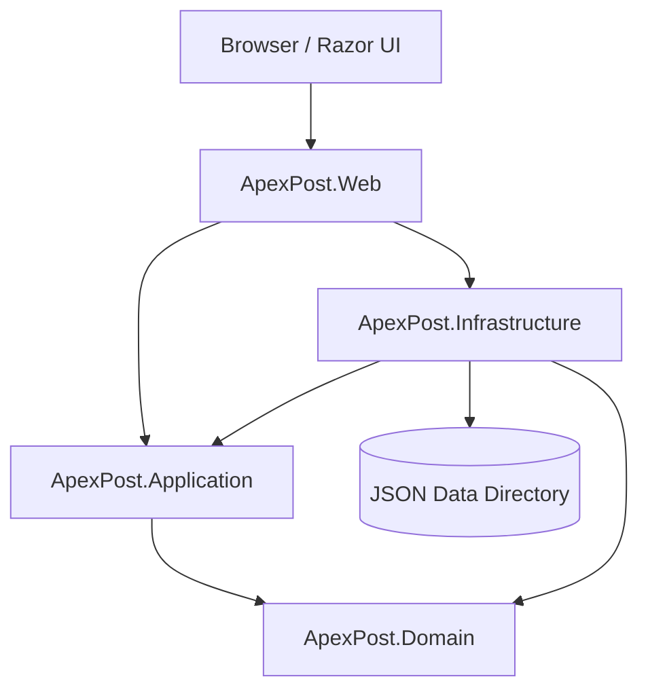
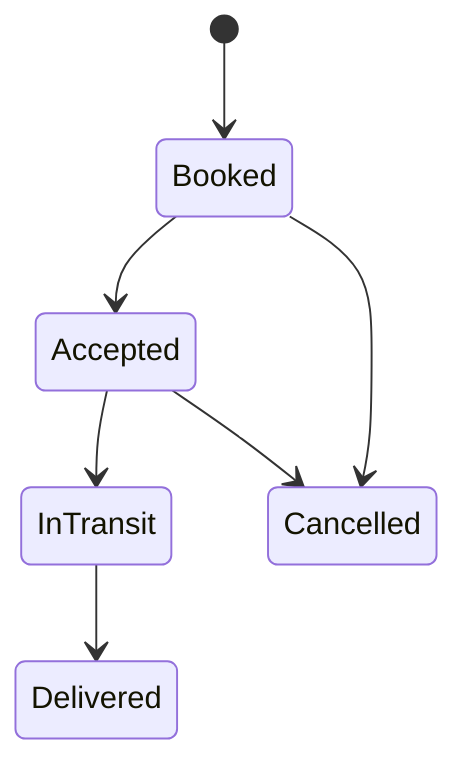

# ApexPost Logistics

**Secure, Observable Retail Counter Platform**

ApexPost Logistics is an ASP.NET Core MVC application for managing branch operations, staff, catalogue services, inventory, shipments, money orders, counter transactions, and operational reporting.

The project uses a layered architecture with domain-driven design principles. Its current persistence implementation uses JSON-backed collections for local development and controlled internal deployments, while keeping application workflows separated from storage-specific implementations.

> **Project status:** Development and controlled-deployment stage. The current JSON persistence model does not provide database-grade transactions, distributed locking, or multi-instance coordination.

---

## Table of Contents

1. [Overview](#1-overview)
2. [Features](#2-features)
3. [Technology Stack](#3-technology-stack)
4. [Architecture](#4-architecture)
5. [Project Structure](#5-project-structure)
6. [Prerequisites](#6-prerequisites)
7. [Getting Started](#7-getting-started)
8. [Configuration](#8-configuration)
9. [Running the Application](#9-running-the-application)
10. [First-User Provisioning](#10-first-user-provisioning)
11. [Authentication and Authorization](#11-authentication-and-authorization)
12. [JSON Persistence](#12-json-persistence)
13. [Seed Data](#13-seed-data)
14. [Inventory and Shipment Workflows](#14-inventory-and-shipment-workflows)
15. [Browser Storage and Offline Behavior](#15-browser-storage-and-offline-behavior)
16. [Testing and Quality Gates](#16-testing-and-quality-gates)
17. [GitHub Actions](#17-github-actions)
18. [Security Guidelines](#18-security-guidelines)
19. [Deployment and Operations](#19-deployment-and-operations)
20. [Troubleshooting](#20-troubleshooting)
21. [Known Limitations](#21-known-limitations)
22. [Future Roadmap](#22-future-roadmap)
23. [Documentation](#23-documentation)

---

## 1. Overview

ApexPost is designed to support the operational activities of retail service branches through a single web application.

The system separates business rules from presentation and persistence. Domain entities enforce business invariants, Application coordinates use cases, Infrastructure handles persistence and adapters, and Web provides the MVC interface and security configuration.

### Project objectives

- Provide controlled access to branch and counter operations.
- Maintain branch, staff, catalogue, inventory, and shipment records.
- Support money-order and counter-transaction workflows.
- Enforce business rules such as valid shipment transitions and non-negative inventory.
- Keep account credentials separate from business seed data.
- Detect malformed persisted JSON instead of silently replacing data.
- Support automated testing and repeatable development setup.
- Maintain a practical path toward transactional database persistence.

### Intended usage

The current design is suitable for:

- Local development and learning.
- Demonstrations and hands-on evaluation.
- Controlled internal deployments with appropriate operational safeguards.

It should not be treated as a fully hardened, horizontally scalable financial platform without additional implementation, testing, and independent security review.

---

## 2. Features

### Branch and staff management

- Branch records and operational status.
- Staff records and branch assignments.
- Role-based access to management and operational workflows.
- Controlled activation and deactivation operations.

### Catalogue and pricing

- Service catalogue management.
- Service availability.
- Service codes and descriptions.
- Pricing records with explicit currency information.

### Inventory management

- Branch-specific inventory.
- Stock receipt and issue operations.
- Stock adjustments.
- Stock movement history.
- Reorder-level monitoring.
- Validation that stock cannot be issued below zero.

### Shipment management

- Sender and recipient information.
- Shipment service selection.
- Package and charge information.
- Shipment lifecycle management.
- Controlled acceptance, dispatch, delivery, and cancellation.

### Money orders and transactions

- Money-order workflow foundations.
- Identity-verification requirements for applicable operations.
- Counter-transaction processing.
- Support for mixed service baskets where implemented.
- Separation of transaction amounts, fees, and taxes.

### Security and observability

- ASP.NET Core cookie authentication.
- Password hashing rather than plaintext password storage.
- Named authorization policies.
- Antiforgery protection for state-changing forms.
- Login rate limiting.
- Correlation identifiers and controlled error handling.
- Safe logging and audit metadata filtering.

### Development and delivery

- Layer-specific automated test projects.
- JSON-backed local persistence.
- Configurable seed data.
- GitHub Actions build and test workflow.
- Documented backup and database-migration strategy.

*The feature list describes the project's intended capabilities. Actual completion should be verified against the implementation and automated tests.*

---

## 3. Technology Stack

| Area | Technology |
|---|---|
| Framework | .NET 10 |
| Language | C# 14 |
| Web application | ASP.NET Core MVC |
| Presentation | Razor views, HTML, CSS, JavaScript |
| Business model | Domain entities and value objects |
| Persistence | JSON-backed collections |
| Browser storage | IndexedDB for non-sensitive local data |
| Authentication | ASP.NET Core cookie authentication |
| Password handling | ASP.NET Core password-hashing facilities |
| Testing | xUnit test projects |
| Source control | Git and GitHub |
| CI | GitHub Actions |
| Future persistence | Relational or document database, to be selected |

The application is designed to keep business logic independent of the current persistence provider.

---

## 4. Architecture

ApexPost uses four main production projects.



### Domain

`ApexPost.Domain` contains business entities, value objects, validation rules, and lifecycle transitions.

Examples include branches, staff members, catalogue services, inventory items, shipments, and money orders.

The Domain layer does not depend on ASP.NET Core or file persistence.

### Application

`ApexPost.Application` coordinates use cases and defines persistence or external-service abstractions.

It contains request and response DTOs, validation outcomes, and application-level workflows. It depends on Domain but not on concrete Infrastructure implementations.

### Infrastructure

`ApexPost.Infrastructure` implements persistence adapters and other technical integrations.

Its responsibilities include JSON serialization, file-backed collection storage, data initialization, seed-data handling, and persistence-specific error handling.

### Web

`ApexPost.Web` is the application's composition root and presentation layer.

It configures dependency injection, authentication, authorization, middleware, controllers, Razor views, browser assets, and health endpoints.

### Dependency rules

- Domain must not reference Application, Infrastructure, or Web.
- Application may reference Domain.
- Infrastructure may implement Application interfaces and use Domain types.
- Web coordinates Application and Infrastructure through dependency injection.
- Controllers should not implement business invariants or write JSON files directly.

For additional detail, see [`DESIGN.md`](DESIGN.md).

---

## 5. Project Structure

The main solution structure is organized as follows:

```text
ApexPost/
├── ApexPost.sln
├── global.json
├── Directory.Build.props
├── Directory.Packages.props
├── .gitignore
├── README.md
├── DESIGN.md
│
├── docs/
│   ├── architecture/
│   ├── adr/
│   └── api/
│
├── data/
│   ├── seed/
│   └── samples/
│
├── src/
│   ├── ApexPost.Domain/
│   ├── ApexPost.Application/
│   ├── ApexPost.Infrastructure/
│   └── ApexPost.Web/
│
├── tests/
│   ├── ApexPost.Domain.Tests/
│   ├── ApexPost.Application.Tests/
│   ├── ApexPost.Infrastructure.Tests/
│   └── ApexPost.Web.Tests/
│
├── scripts/
│   ├── validate-seed-data.ps1
│   └── run-tests.ps1
│
└── .github/
    └── workflows/
        └── ci.yml
```

This is the intended high-level structure. Some documentation files, scripts, or workflow components may still be under development.

---

## 6. Prerequisites

Install the following before building the application:

- [.NET 10 SDK](https://dotnet.microsoft.com/download/dotnet/10.0)
- Git
- A code editor such as Visual Studio Code or Visual Studio
- A browser
- A writable application-data directory

Verify your .NET installation:

```powershell
dotnet --info
dotnet --list-sdks
```

Confirm that the SDK version selected by `global.json` is available on your machine. If the required SDK is not installed, the CLI may fail before building the solution.

---

## 7. Getting Started

### Step 1: Clone the repository

```powershell
git clone <YOUR_REPOSITORY_URL>
cd ApexPost
```

Replace the placeholder with your actual Git repository URL.

If you already have the project locally, open PowerShell in the directory containing `ApexPost.sln`.

### Step 2: Restore dependencies

```powershell
dotnet restore ApexPost.sln
```

### Step 3: Build the solution

```powershell
dotnet build ApexPost.sln --configuration Release
```

The build should complete without errors before proceeding.

### Step 4: Run automated tests

```powershell
dotnet test ApexPost.sln --configuration Release
```

### Step 5: Configure local application data

For an isolated development environment, configure a dedicated data directory:

```powershell
$env:ApexPost__JsonData__DataDirectory = "$HOME\ApexPost\data"
```

Enable seed data only when you intentionally want to initialize an empty development dataset:

```powershell
$env:ApexPost__JsonSeed__Enabled = "true"
```

### Step 6: Start the application

```powershell
dotnet run --project src/ApexPost.Web/ApexPost.Web.csproj --urls http://localhost:5100
```

Follow the startup output for the actual listening address and any HTTPS redirection behavior. If the application redirects to HTTPS, use the configured HTTPS URL and ensure the development certificate is trusted.

---

## 8. Configuration

ApexPost uses standard ASP.NET Core configuration providers, including JSON settings and environment variables.

### Example `appsettings.json`

```json
{
  "ApexPost": {
    "JsonData": {
      "DataDirectory": "App_Data"
    },
    "JsonSeed": {
      "Enabled": false
    }
  }
}
```

This is an example of the expected configuration shape. Keep the actual option names consistent with the project's configuration binding.

### Common configuration settings

| Setting | Purpose |
|---|---|
| `ApexPost:JsonData:DataDirectory` | Directory for persisted JSON collections |
| `ApexPost:JsonSeed:Enabled` | Enables or disables business seed initialization |
| `ApexPost:DevelopmentAccounts:Enabled` | Enables configured development accounts when supported |
| `ApexPost:DevelopmentAccounts:{Role}:UserName` | Development username for a role |
| `ApexPost:DevelopmentAccounts:{Role}:Password` | Development password for a role |

### PowerShell environment variables

```powershell
$env:ApexPost__JsonData__DataDirectory = "$HOME\ApexPost\data"
$env:ApexPost__JsonSeed__Enabled = "false"
```

ASP.NET Core maps double underscores in environment-variable names to configuration key separators.

Environment variables set this way apply to the current PowerShell session. They do not automatically persist after that session closes.

### User Secrets

For local development, use User Secrets for sensitive configuration when supported by the Web project:

```powershell
dotnet user-secrets init --project src/ApexPost.Web/ApexPost.Web.csproj
dotnet user-secrets set "ApexPost:DevelopmentAccounts:Enabled" "true" --project src/ApexPost.Web/ApexPost.Web.csproj
```

Do not commit real passwords, production credentials, or secret configuration files to source control.

---

## 9. Running the Application

Run the Web project from the repository root:

```powershell
dotnet run --project src/ApexPost.Web/ApexPost.Web.csproj
```

Alternatively, specify a local URL:

```powershell
dotnet run --project src/ApexPost.Web/ApexPost.Web.csproj --urls http://localhost:5100
```

If HTTPS redirection is enabled, configure and use the HTTPS endpoint for browser verification.

### Useful local checks

1. Confirm that the application starts successfully.
2. Confirm that the configured data directory is the intended one.
3. Open the login page.
4. Complete first-user provisioning if no account exists.
5. Verify that unauthorized users cannot access protected routes.
6. Verify that authorized users can access their permitted dashboard.
7. Review application logs for startup or persistence errors.

Do not assume that an application is healthy solely because the process starts. Test the workflows and permissions that matter to the environment.

---

## 10. First-User Provisioning

ApexPost does not require a hard-coded default production username or password.

On a clean environment, the first administrator is provisioned through the application's bootstrap workflow, if enabled by the current implementation.

Typical local URL:

```text
https://localhost:5100/Account/Bootstrap
```

Use the actual HTTPS address shown by the application if it differs.

### Bootstrap requirements

- Use a strong, unique password.
- Ensure the configured data directory is the intended directory.
- Confirm that no existing account data will be overwritten.
- Complete provisioning before relying on authenticated management functions.
- Verify that bootstrap becomes unavailable after the initial account is created, if that is the implemented behavior.

After provisioning, sign in through:

```text
https://localhost:5100/Account/Login
```

Additional users should be created through the authorized account-provisioning workflow.

**Important:** Never delete the application-data directory simply to make the bootstrap page appear. Doing so may remove operational records. Only reset a disposable development environment after confirming the correct path and a verified backup.

---

## 11. Authentication and Authorization

ApexPost uses ASP.NET Core cookie authentication for browser-based sign-in.

### Security controls

The intended controls include:

- Password hashes instead of plaintext passwords.
- Secure cookie configuration for deployed HTTPS environments.
- `HttpOnly` cookies.
- An appropriate `SameSite` policy.
- Login rate limiting.
- Antiforgery validation on state-changing forms.
- Named authorization policies.
- Server-side permission checks.
- Safe access-denied and error handling.

### Application roles

The project documentation identifies the following application roles:

| Role | Intended responsibility |
|---|---|
| `Administrator` | User provisioning and authorized administration |
| `BranchManager` | Branch operations and management |
| `CounterStaff` | Counter and customer-service operations |
| `InventoryStaff` | Inventory receipt, issue, and stock operations |
| `Auditor` | Read-only operational and audit review |

The exact access granted to each role depends on the policies and controller/action attributes implemented in the application. Review the current authorization configuration before relying on these role descriptions.

### Development-only accounts

If development-account initialization is implemented, it should only run when explicitly enabled in the Development environment.

Example PowerShell configuration:

```powershell
$env:ApexPost__DevelopmentAccounts__Enabled = "true"

$env:ApexPost__DevelopmentAccounts__Administrator__UserName = "admin.dev"
$env:ApexPost__DevelopmentAccounts__Administrator__Password = "<USE-A-UNIQUE-LOCAL-SECRET>"
```

Configure other roles only when needed. Use unique local passwords and never reuse these examples as real credentials.

Production startup must not create development accounts from development-only settings.


## First-user provisioning

The application does not ship with a default production account or embedded password.

On a clean system, before any local account exists, open:

```text
https://localhost:5100/Account/Bootstrap
```

Create the first administrator account with a strong password (12+ characters, unique to that environment). The bootstrap page is only available while no accounts exist.

After the first login:

- Create additional users from `/Account/Provision`.
- Use the least privileged role needed for each user.
- Roles are limited to `Administrator`, `BranchManager`, and `CounterClerk`.
- Use a dedicated admin account rather than a shared or personal account.

## Authentication and authorization

- ASP.NET Core cookie authentication is used for MVC sign-in.
- Passwords are never stored in plaintext; the app persists only PasswordHasher output.
- Login is protected by rate limiting and antiforgery tokens.
- Cookies are `HttpOnly`, secure-only, and configured for HTTPS use.
- Access control uses role policies for management and administrator-only actions.
- Unauthorized users are redirected to `/Account/AccessDenied`.

### Supported roles and permissions

ApexPost supports five application roles:

| Role | Purpose | Typical access |
| --- | --- | --- |
| `Administrator` | Full administration and provisioning | Full management access, user provisioning, and report access |
| `BranchManager` | Branch operations lead | Branch and staff management, inventory, operational workflows |
| `CounterStaff` | Counter sales and service desk | Transactions, payments, shipments, counter operations |
| `InventoryStaff` | Warehouse and stock handling | Inventory movement, receiving, issuing, stock actions |
| `Auditor` | Read-only monitoring and review | Reports, audit records, non-mutating review only |

The `Auditor` role is intentionally read-only and cannot access state-changing controllers or actions.

### Development accounts and secure provisioning

The project does not ship a default username or password. Each environment must be provisioned explicitly.

For local development, enable development role accounts through configuration or user secrets and set one username/password pair per role. The app only creates the configured accounts when `ApexPost:DevelopmentAccounts:Enabled=true` and the environment is `Development`.

Example PowerShell values:

```powershell
# One-time local values in user secrets or environment variables
$env:ApexPost__DevelopmentAccounts__Enabled = "true"
$env:ApexPost__DevelopmentAccounts__Administrator__UserName = "admin.dev"
$env:ApexPost__DevelopmentAccounts__Administrator__Password = "ChangeThis-StrongDevPass-123!"
$env:ApexPost__DevelopmentAccounts__BranchManager__UserName = "branch.dev"
$env:ApexPost__DevelopmentAccounts__BranchManager__Password = "ChangeThis-StrongDevPass-456!"
$env:ApexPost__DevelopmentAccounts__CounterStaff__UserName = "counter.dev"
$env:ApexPost__DevelopmentAccounts__CounterStaff__Password = "ChangeThis-StrongDevPass-789!"
$env:ApexPost__DevelopmentAccounts__InventoryStaff__UserName = "inventory.dev"
$env:ApexPost__DevelopmentAccounts__InventoryStaff__Password = "ChangeThis-StrongDevPass-101!"
$env:ApexPost__DevelopmentAccounts__Auditor__UserName = "auditor.dev"
$env:ApexPost__DevelopmentAccounts__Auditor__Password = "ChangeThis-StrongDevPass-202!"
```

Equivalent user-secrets configuration:

```powershell
dotnet user-secrets set "ApexPost:DevelopmentAccounts:Enabled" "true"
dotnet user-secrets set "ApexPost:DevelopmentAccounts:Administrator:UserName" "admin.dev"
dotnet user-secrets set "ApexPost:DevelopmentAccounts:Administrator:Password" "ChangeThis-StrongDevPass-123!"
# Repeat for BranchManager, CounterStaff, InventoryStaff, and Auditor.
```

The app will create each configured account once and never overwrite an existing account or password. If a role is configured without both `UserName` and `Password`, startup fails with a clear error. In production, startup skips development account initialization entirely.

### Portal login

- URL: `https://localhost:5100/Account/Login` (or the configured local URL)
- Sign in with a valid user name and password for the role you created.
- After successful login, the app redirects to a role-specific dashboard route such as `/dashboard/admin`, `/dashboard/branch`, `/dashboard/counter`, `/dashboard/inventory`, or `/dashboard/auditor`.
- New accounts are provisioned by an Administrator from `/Account/Provision`.
- Only Administrators can assign roles or create users.


---

## 12. JSON Persistence

ApexPost currently stores operational data in JSON-backed collections.

### Data directory

The default may be `App_Data`, depending on the configured application settings. Relative paths are resolved according to the application's runtime behavior, so deployments should use an explicit, stable directory.

Example:

```powershell
$env:ApexPost__JsonData__DataDirectory = "C:\ApexPost\data"
```

On Linux:

```bash
export ApexPost__JsonData__DataDirectory="$HOME/ApexPost/data"
```

### Persistence principles

- Keep operational data separate from source code and static web content.
- Restrict filesystem permissions to the application identity and authorized operators.
- Validate persisted JSON before modifying it.
- Preserve existing operational data during initialization.
- Report malformed or unreadable files clearly.
- Back up data before risky changes.
- Test restore procedures periodically.

### Account data isolation

Account and login data must remain separate from business seeding. The seed initializer must not create or reset passwords, replace accounts, or overwrite existing login records.

### Backup and recovery

JSON files are operational state. Back up the configured data directory, protect the backup, and verify restoration before depending on it for recovery.

JSON persistence does not provide automatic multi-file transactions. A workflow that updates multiple collections can fail partway through; the application must explicitly handle that risk.

---

## 13. Seed Data

Seed data supports repeatable development and demonstrations.

### Enable seeding

In PowerShell:

```powershell
$env:ApexPost__JsonData__DataDirectory = "$HOME\ApexPost\seeded-data"
$env:ApexPost__JsonSeed__Enabled = "true"

dotnet run --project src/ApexPost.Web/ApexPost.Web.csproj
```

Use a new, dedicated directory for a clean seed run.

### Seed-data rules

- Enable seeding only when you intentionally want demo data.
- Seed records should satisfy domain invariants.
- Related records must reference valid entities.
- Stable identifiers should be used where idempotency requires them.
- Re-running initialization must not create duplicate seed records.
- Existing operational data must not be silently replaced.
- Account data must not be included in business seed data.
- Malformed existing JSON must produce a clear failure rather than automatic replacement.

### Inventory seed records

Inventory records should be initialized through the domain model so that quantity on hand and stock-movement history remain consistent. Stock must never become negative.

### Shipment seed records

Shipment seed records should reference valid seeded catalogue services and use valid shipment-party, package, and charge data. Statuses must be established through valid domain lifecycle transitions or validated restoration logic.

### Disable seeding

After initialization, disable seed mode unless it is intentionally required for the environment:

```powershell
$env:ApexPost__JsonSeed__Enabled = "false"
```

Do not enable seeding against a production or live operational data directory.

---

## 14. Inventory and Shipment Workflows

### Inventory workflow

A typical stock operation follows this sequence:

1. Validate the branch and inventory item.
2. Verify that the operator is authorized.
3. Validate the requested quantity and reason.
4. Invoke the appropriate domain operation.
5. Persist the resulting inventory state and movement history.
6. Return a success or failure result.
7. Record audit metadata where required.

The domain model rejects issuing more stock than is available and disallows negative quantities or reorder levels.

### Shipment workflow

The supported domain lifecycle is designed around the following transitions:



A typical shipment workflow validates the sender, recipient, service, package, charge, branch, and operator permissions before persisting the booking.

A shipment cannot be delivered directly from the booked state, and cancellation is not permitted after dispatch under the current domain rules.

---

## 15. Browser Storage and Offline Behavior

ApexPost may use IndexedDB for non-sensitive drafts and queue metadata.

Browser storage is not the authoritative record of a completed operation. Local data can be altered or deleted by the user and must be revalidated by the server before processing.

### Prohibited local data

Do not store the following in IndexedDB:

- Passwords or password hashes.
- Authentication tokens or session secrets.
- Identity documents or sensitive verification evidence.
- Payment credentials.
- Sensitive account data.

### Manual verification

1. Open the application dashboard.
2. Verify offline indicators under the intended network conditions.
3. Save a harmless test draft if the feature is implemented.
4. Confirm that sensitive fields are rejected by the browser-storage validation.
5. Confirm that pending operations are not displayed as completed transactions.
6. Confirm that server synchronization is required before an operation is considered confirmed.

---

## 16. Testing and Quality Gates

The solution is organized into four test projects:

| Test project | Responsibility |
|---|---|
| `ApexPost.Domain.Tests` | Business rules and domain invariants |
| `ApexPost.Application.Tests` | Use cases and application outcomes |
| `ApexPost.Infrastructure.Tests` | JSON persistence and seed initialization |
| `ApexPost.Web.Tests` | HTTP behavior and security controls |

### Run the complete test suite

```powershell
dotnet test ApexPost.sln --configuration Release
```

### Build and test separately

```powershell
dotnet build ApexPost.sln --configuration Release

dotnet test ApexPost.sln --configuration Release --no-build
```

### Recommended delivery gates

1. **Requirements:** acceptance criteria and business rules are clear.
2. **Development:** implementation follows the layer boundaries.
3. **Code review:** correctness, security, and maintainability are checked.
4. **Quality assurance:** relevant tests pass.
5. **Integration:** build, configuration, and related workflows are verified.
6. **Deployment:** operational settings and smoke tests are confirmed.

A successful build does not replace automated tests or security verification.

---

## 17. GitHub Actions

The repository may use `.github/workflows/ci.yml` to automate the build and test process.

The documented baseline workflow runs on pushes to `main` and pull requests targeting `main`. It restores dependencies, builds in Release mode, and runs the test suite.

Typical local equivalents are:

```powershell
dotnet restore ApexPost.sln
dotnet build ApexPost.sln --configuration Release
dotnet test ApexPost.sln --configuration Release
```

Before relying on CI, confirm that the workflow file exists and that its branch filters match your current GitHub workflow.

Future pipeline improvements may include code coverage, dependency vulnerability scanning, artifact publication, and controlled deployment stages.

---

## 18. Security Guidelines

### Credentials and secrets

- Never commit passwords, API keys, or provider secrets.
- Use User Secrets for local development when appropriate.
- Use a managed secret store or protected deployment configuration for production.
- Do not put real credentials in seed files or sample configuration.
- Rotate any secret that is accidentally committed or exposed.

### Authorization

- Enforce access restrictions on the server.
- Apply named authorization policies consistently.
- Add resource-level checks where access depends on branch or record ownership.
- Do not treat hidden navigation links as access control.

### Logging and auditing

- Avoid logging passwords, tokens, identity documents, or payment secrets.
- Redact sensitive fields before recording audit metadata.
- Return safe error messages rather than stack traces.
- Use correlation identifiers for troubleshooting without embedding sensitive information.

### Operational security

- Keep data directories outside public web content.
- Restrict filesystem permissions.
- Use HTTPS in deployed environments.
- Back up operational data and test restoration.
- Review production configuration before every release.

The existence of a control in this README does not independently prove that the implementation is complete. Verify it through code review and tests.

---

## 19. Deployment and Operations

The current design assumes a single application instance with a protected, persistent JSON data directory.

### Before deployment

- [ ] Confirm the target .NET runtime or publishing model.
- [ ] Build and test the Release configuration.
- [ ] Configure the data-directory path explicitly.
- [ ] Verify the application identity's filesystem permissions.
- [ ] Disable development accounts and unintended seed initialization.
- [ ] Configure HTTPS and secure cookies.
- [ ] Verify authentication and authorization.
- [ ] Back up operational data.
- [ ] Confirm logging and health endpoints do not disclose sensitive information.
- [ ] Perform smoke tests after deployment.

### Data retention

Operational records and audit data may have different retention requirements. Define retention, archival, backup, and deletion procedures before the application is used for real business operations.

### Scaling considerations

Do not deploy multiple instances against the same JSON directory and assume that writes are coordinated. Multi-instance operation requires explicit concurrency and consistency guarantees that the current design does not inherently provide.

---

## 20. Troubleshooting

### The application cannot find the .NET SDK

Check:

```powershell
dotnet --info
dotnet --list-sdks
```

Confirm that the SDK required by `global.json` is installed.

### The application cannot write to the data directory

- Check `ApexPost:JsonData:DataDirectory`.
- Confirm that the resolved directory is correct.
- Verify filesystem permissions.
- Ensure the application identity can create and modify the required files.

### Seed data does not appear

- Confirm `ApexPost:JsonSeed:Enabled` is bound correctly.
- Confirm initialization is invoked during application startup.
- Verify the configured data directory.
- Check whether existing files prevent initialization or cause validation errors.
- Inspect startup logs for persistence exceptions.

### The bootstrap page is unavailable

The application may already have account records in the configured data directory, or the bootstrap route may be disabled by the current configuration.

Verify the data path before changing or deleting files. Never reset a live data directory to bypass bootstrap protection.

### Malformed JSON prevents startup

- Stop the application.
- Identify the affected file from the error.
- Preserve a copy for investigation.
- Restore a known-good backup or repair the file using a controlled procedure.
- Verify the configured directory before restarting.

Do not delete malformed data without understanding its operational significance.

### Login fails

- Confirm that the account exists in the configured data directory.
- Verify that the application is using the expected environment and settings.
- Check the login and authentication logs without exposing credentials.
- Confirm that development-account initialization is enabled only in the intended environment.
- Verify that the account has not been deactivated or otherwise restricted.

### HTTP redirects unexpectedly to HTTPS

Check the configured HTTPS endpoint and ASP.NET Core HTTPS-redirection settings. Use the HTTPS URL and trust the local development certificate when required.

### Tests fail after a domain change

Review the relevant domain invariants, update affected test fixtures, and verify that infrastructure restoration still creates valid domain objects. Do not weaken business rules merely to make existing tests pass.

---

## 21. Known Limitations

The current implementation and architecture have the following known boundaries:

- Persistence is JSON-based rather than database-backed.
- Multi-file business operations are not inherently atomic.
- Distributed locking and multi-instance coordination are not provided automatically.
- Payment and identity verification may be simulated rather than integrated with external providers.
- IndexedDB is local, mutable client-side storage.
- Production readiness depends on verifying the implementation and operational controls.
- This documentation is not a substitute for a full threat model or independent penetration test.

These limitations should be considered when deciding whether the system is suitable for a particular deployment.

---

## 22. Future Roadmap

### Phase 1 — Domain and application foundations

- Complete domain entities and value objects.
- Implement application use cases and repository contracts.
- Standardize validation and result handling.
- Expand domain and application test coverage.

### Phase 2 — JSON persistence and seed data

- Complete JSON persistence adapters.
- Validate safe startup and initialization.
- Add repeatable, idempotent seed data.
- Test inventory and shipment restoration.
- Verify malformed-data and recovery behavior.

### Phase 3 — Web workflows and security

- Complete MVC screens and operational workflows.
- Apply authorization policies consistently.
- Verify antiforgery and login rate limiting.
- Improve audit events, correlation IDs, and error handling.

### Phase 4 — Delivery and operations

- Enforce automated quality gates.
- Document environment-specific configuration.
- Add operational backup and restoration procedures.
- Improve logging, health checks, and deployment verification.

### Phase 5 — Database migration

- Select a suitable relational or document database.
- Implement database adapters behind existing repository interfaces.
- Add schema migration and data-import tooling.
- Introduce appropriate transactional boundaries and concurrency controls.
- Validate data integrity and recovery before cutover.

The roadmap is directional. Mark a phase complete only after its deliverables have been implemented and verified.

---

## 23. Documentation

| Document | Purpose |
|---|---|
| `README.md` | Setup, configuration, execution, testing, and operations |
| `DESIGN.md` | System architecture, domain boundaries, security, persistence, and migration strategy |
| `docs/architecture/` | Architecture and implementation conventions |
| `docs/adr/` | Architecture Decision Records and the rationale behind significant choices |
| `docs/api/` | API and endpoint documentation where applicable |
| `scripts/` | Development and validation utilities |
| `.github/workflows/ci.yml` | Automated build and test pipeline |

---

## License

Add the project's selected license here before public distribution. Do not imply that the repository is open-source under a particular license until that license has been chosen and included.

---

**ApexPost Logistics** is intended to evolve through small, verifiable engineering steps. Its central design goal is to keep business rules explicit, security controls centralized, persistence replaceable, and operational behavior understandable as the application grows.
