# Domain model

## Scope

The current domain model is small but realistic for a local branch-operations system. It includes the core aggregates and value objects needed for registration, inventory movement, shipment handling, money-order issuance, transactions, and audit reporting.

## Core aggregates

```mermaid
classDiagram
    class Branch {
        +Guid Id
        +string Code
        +string Name
        +BranchAddress Address
        +int CounterCount
        +BranchStatus Status
    }

    class StaffMember {
        +Guid Id
        +string EmployeeNumber
        +string Name
        +Guid BranchId
        +StaffRole[] Roles
        +EmploymentStatus Status
    }

    class ServiceDefinition {
        +Guid Id
        +string Code
        +string Name
        +string Description
        +ServiceAvailability Availability
    }

    class InventoryItem {
        +Guid Id
        +Guid BranchId
        +string Sku
        +string Name
        +int QuantityOnHand
        +int ReorderLevel
        +bool NeedsReorder
    }

    class Shipment {
        +Guid Id
        +string Number
        +ShipmentParty Sender
        +ShipmentParty Recipient
        +decimal ChargeAmount
        +ShipmentStatus Status
    }

    class MoneyOrder {
        +Guid Id
        +MoneyOrderNumber Number
        +decimal Amount
        +MoneyOrderStatus Status
        +Guid OriginatingBranchId
    }

    class RetailTransaction {
        +Guid Id
        +Guid BranchId
        +decimal Total
        +TransactionStatus Status
        +IReadOnlyCollection<PaymentRecord> Payments
    }

    class PaymentRecord {
        +decimal Amount
        +PaymentMethod Method
        +PaymentStatus Status
    }
```

## Key invariants

- Branch codes and staff employee numbers are validated at the domain boundary.
- Inventory movements are governed by reorder, issue, and receive rules.
- Shipment status changes follow lifecycle transitions such as booked, accepted, in transit, delivered, and cancelled.
- Money orders are not treated as fully confirmed until the target state is reached.
- Transaction totals and payment records must remain consistent with the aggregate status.
- Identity verification records are separate from operational authentication and should not be confused with local MVC user accounts.

## Implementation notes

This repository currently uses file-backed JSON persistence with versioned records rather than a relational database. The domain layer remains responsible for business invariants even though persistence is implemented in infrastructure adapters.
