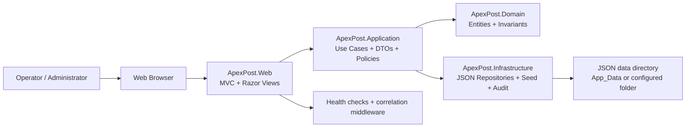

# System architecture

## Overview

ApexPost is an ASP.NET Core MVC application designed for local branch operations, inventory tracking, money orders, reporting, and secure local account access.

## Responsibilities

### Web layer

- MVC controllers and Razor views
- cookie authentication and authorization
- antiforgery validation and rate limiting
- health check endpoints and correlation ID middleware
- browser-side storage assets for safe local queue/draft state

### Application layer

- orchestration of branch, staff, shipment, inventory, payment, and reporting workflows
- validation results and domain integration contracts
- repository abstractions for persistence operations

### Domain layer

- core entities and invariants for operational behavior
- business rules for pricing, packing, shipment stages, and transaction status

### Infrastructure layer

- JSON persistence
- file validation and atomic writes
- seed initialization
- audit writing with sensitive-field rejection

## Current implementation status

### Implemented

- secure local account bootstrap and sign-in
- role-based authorization
- management flows for branches, staff, catalogue, inventory, shipments, reports
- JSON-based persistence and seed data initialization
- safe health checks and correlation IDs
- browser-side IndexedDB for non-sensitive draft and queue metadata

### Partially implemented

- operational reporting is implemented but remains local-file based
- audit and recovery behaviors are implemented but not enterprise-grade

### Planned

- external identity provider integration
- managed database migration
- enterprise telemetry and broader operational automation

## Architectural constraints

The current repository is intentionally simple and local. It is suitable for development and controlled internal testing, but it is not a multi-instance production database solution.
